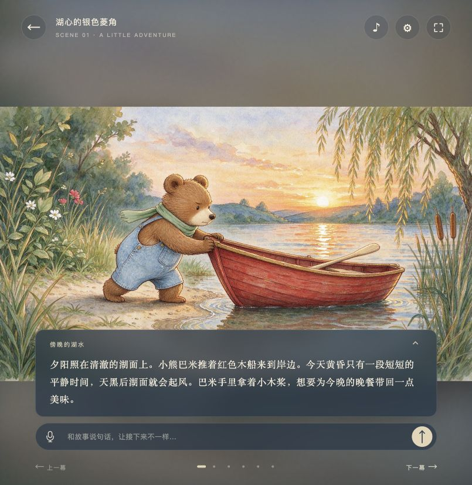
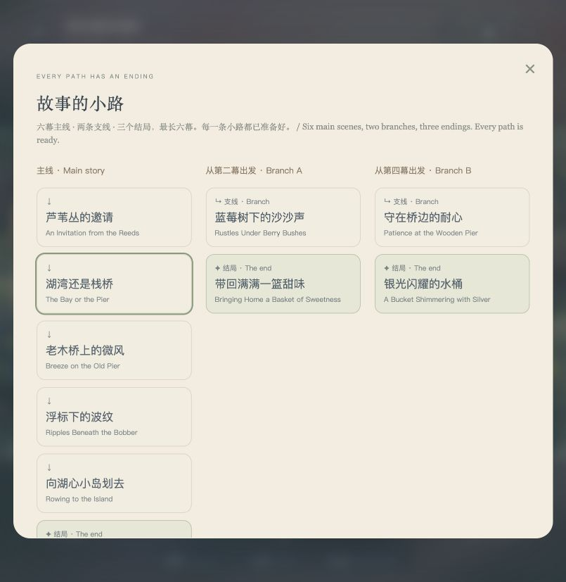

# 月亮书房 / Moonlit Stories

全屏、沉浸式、可交互的 AI 动态童书原型。家长输入知识点，先准备完整故事，再让孩子选择封面进入阅读。

An immersive AI storybook prototype. Parents set the knowledge points and prepare complete stories before children choose a cover and start reading.

**Live demo / 在线体验:** [storybook.david-widgets.com](https://storybook.david-widgets.com/)




[Character animation preview / 角色动作预览](docs/character-motion.mp4)



## How it works / 体验流程

1. 家长输入 1–3 个知识点，一行一个，并选择年龄段。无需填写故事标题或剧情。 Parents enter one to three knowledge points and an age band.
2. AI 依次准备三本带有限故事树的童书，每本包含六幕主线、两条两幕支线和三个结局，共十幅插画与十段角色动画。 AI prepares three finite story trees: six main scenes, two two-scene branches and three endings per book, with ten illustrations and ten character clips each.
3. 三本的全部插画与角色动画生成后，首页一起展示实际封面和故事名称。孩子点开即可阅读和播放角色动作，不触发故事、插画或动画生成。 All illustrations and character clips are generated before covers appear. Still images are preloaded; owned clips stream with byte-range support and start playing when a scene opens, without an AI call.
4. 孩子在第二幕和第四幕选择故事中的行动，沿已准备好的路线抵达结局；阅读不调用 AI。 Children choose actions at the second and fourth main scenes, following prepared paths to an ending without AI calls.
5. 一键导出完整 HTML 绘本，包含整棵故事树、全部插画与动效，可离线阅读。 One click exports a self-contained HTML book with the full tree, all illustrations, character clips and SVG motion for offline reading.

准备过程中刷新会继续查询当前任务。失败后可以保持相同设置，继续准备剩余故事，复用已经完成的部分；不自动重试结果不确定的付费调用。

Refreshing resumes the existing job. Explicitly continuing the same settings after failure keeps completed books and prepares the missing ones. Uncertain paid calls are not retried automatically.

## Local setup / 本地运行

Requires Python 3.9 or newer; the local server uses only the standard library. 本地服务仅需 Python 标准库。

```sh
git clone https://github.com/drdavid-kor/moonlit-storybook.git
cd moonlit-storybook
export OPENROUTER_API_KEY="<your OpenRouter API key>"
python3 server.py --port 8766
```

Open [http://127.0.0.1:8766](http://127.0.0.1:8766). AI calls run on the server; the key is never returned to the browser. Without a key, the interface still loads and the generation API reports that configuration is needed.

打开本机地址即可。API Key 只在服务端使用。未配置 Key 时页面仍可打开，生成功能会提示需要配置。

The default text model is `google/gemini-3.8-flash`; illustrations use `bytedance-seed/seedream-5-0-flash` through OpenRouter's image API; character motion uses `bytedance/seedance-1-5-pro` through the video API; voice transcription uses `qwen/qwen3-asr-0.6b`. Model availability can change. Set `STORYBOOK_MODEL` to override the local text model after checking its structured-output support.

若本机安装了 Codex OpenRouter skill，服务也可以使用它的私有凭据助手；`OPENROUTER_HELPER` 可指定兼容助手的路径。普通克隆无需安装该 skill，仓库附带只读取环境变量的小型客户端。

An installed Codex OpenRouter skill is optional. Its compatible credential helper can be selected with `OPENROUTER_HELPER`; ordinary clones use the bundled environment-based client.

## Cloudflare deployment / 云端部署

The public version uses Cloudflare Workers, D1, private R2 image/video storage and Workflows. Node.js and npm are needed for Wrangler. See [cloud/DEPLOYMENT.md](cloud/DEPLOYMENT.md) for the complete setup.

公开版使用 Worker 提供 API 与静态页面、D1 保存匿名故事库、Workflows 执行持久生成任务。生产环境配置留在本地；仓库提供可填写的部署模板。

```sh
npm ci
cp cloud/wrangler.example.jsonc cloud/wrangler.jsonc
# Create your D1 database and fill its ID in cloud/wrangler.jsonc.
npm run check
npm run build
```

`cloud/wrangler.jsonc` is ignored by Git. The example does not contain the live site's account, database ID or domain route.

## Controls and boundaries / 交互与原型边界

- Story-specific 2K illustrations and 4-second, silent 720p image-to-video character loops. Characters blink, turn their heads and move their bodies while the camera stays fixed. SVG atmosphere is retained. The reader has a pause/play control and respects the saved motion preference. 每幕插画预生成 4 秒、无声、720p 角色动画，角色眨眼、转头并改变身体姿态，镜头固定；保留 SVG 氛围动效，可暂停或播放。
- Bilingual subtitles, keyboard navigation, optional system narration and voice-to-text input. 支持双语字幕、键盘翻幕、系统朗读与语音转文字。
- Each illustration uses the current route’s past events and the first image as an identity/style reference. Main actions remain above a lower caption-safe area. 插画只使用本路线的前文，参考首幕角色与画风；主要动作置于底部字幕安全区上方。
- Parents can prepare illustrations and character motion for older books from the saved-story library, without rewriting their text. Incomplete books are excluded from the child's shelf. 旧故事由家长在故事库中补齐插画和角色动画；未完成全部插画的绘本不进入孩子的故事卡片。
- Provider video originals can be large. The current demo clips were compressed to H.264 with fast-start metadata while retaining 720p. The cloud generator stores provider outputs; playback streams one scene with byte-range support, while export downloads the complete book. 原始视频可能较大；当前演示片段已压缩为保留 720p 的 H.264。云端生成保留服务商输出，阅读逐幕流式播放，导出会下载整本动画。
- Character motion is generated video, rather than an articulated SVG character rig. The model can introduce small visual changes; exact anatomy, motion continuity and perfectly seamless loops are not guaranteed. This prototype does not establish children's learning outcomes. 角色动作通过 AI 短视频生成，可能出现细节漂移，无法保证精确骨骼动作或完全无缝循环；尚未验证儿童学习效果。
- All three endings close their own route and include a route-specific discovery. Older books remain finite linear stories. Live continuation is disabled in the UI and the API. 三个结局各自收束路线并给出对应的小发现；旧绘本仍按有限主线阅读，界面和接口均已关闭实时续写。

## Data and credentials / 数据与凭据

Knowledge points, page text and reference illustrations (including first/last frames for animation) are processed through OpenRouter. Audio is forwarded for transcription and not stored by this app. Calls may incur provider charges. Images and clips are private and fetched through the same session-checked API as stories.

知识点、故事文字、参考插画与家长录音通过 OpenRouter 处理。录音仅用于转录，本应用不保存录音。真实模型调用可能产生费用。图片通过同源接口按会话读取。

The cloud library belongs to an anonymous browser session protected by an HttpOnly, Secure, SameSite cookie. It has no accounts or cross-device synchronization. Records older than 30 days are removed by a daily cleanup; deletion can take up to one extra day. Browser settings, prepared shelf IDs and subtitle position stay in localStorage. Exported HTML contains story content and embedded images and video clips, with no provider credentials or network access.

公开版故事库按匿名浏览器会话隔离，没有账号或跨设备同步。云端每日清理超过 30 天的记录；知识设置、封面选择和字幕位置保存在当前浏览器。导出文件含故事、图片与角色动画，可由用户自行保存或分享。

The Python server listens only on `127.0.0.1` and keeps shared local records in `data/`. It is a local development server, not the production multi-visitor backend. Runtime records, secrets, verification receipts and personal deployment configuration are excluded from this repository.

本地 Python 服务仅监听回环地址，使用本机共享数据目录。对外服务请使用云端实现。

## Checks / 验证

```sh
npm run check
python3 -m py_compile server.py scripts/*.py
# After configuring Wrangler:
npm run build
# Optional: check a deployed HTTPS instance without paid generation:
STORYBOOK_URL=https://your-worker.example python3 scripts/verify-public.py
```

See [docs/VERIFICATION.md](docs/VERIFICATION.md) for what was verified on the live prototype and its limits.

## Source layout / 目录

- `public/`: fullscreen UI, styling, SVG scene renderer and interaction logic.
- `server.py`: local Python API and asynchronous generation.
- `scripts/openrouter_client.py`: portable server-side OpenRouter client.
- `cloud/`: Worker, constrained story schemas, shared art direction, private-image/video generation, D1 migrations and deployment template.
- `docs/`: preview and verification summary.
- `data/`, `verification/`: local runtime and receipts, ignored by Git.
