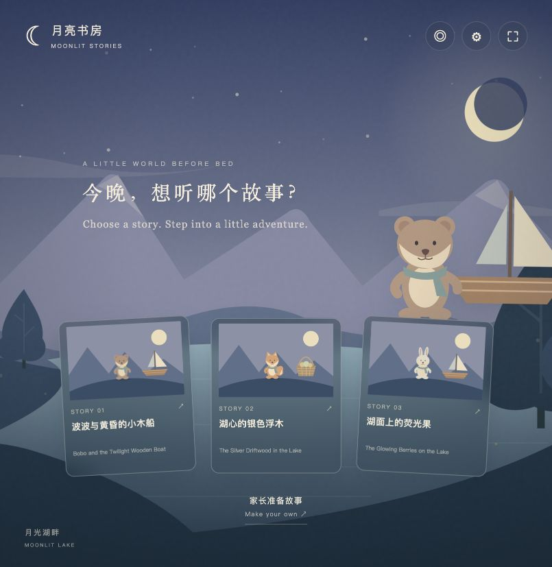

# 月亮书房 / Moonlit Stories

全屏、沉浸式、可交互的 AI 动态童书原型。家长输入知识点，先准备完整故事，再让孩子选择封面进入阅读。

An immersive AI storybook prototype. Parents set the knowledge points and prepare complete stories before children choose a cover and start reading.

**Live demo / 在线体验:** [storybook.david-widgets.com](https://storybook.david-widgets.com/)



## How it works / 体验流程

1. 家长输入 1–3 个知识点，一行一个，并选择年龄段。无需填写故事标题或剧情。 Parents enter one to three knowledge points and an age band.
2. AI 依次准备三个完整的六幕童书。一个知识点可以演绎不同故事；多个知识点轮流作为故事核心。 AI prepares three six-scene books, with different stories around one point or core points assigned in rotation.
3. 三本都完成后，首页一起展示实际封面和故事名称。孩子点开即可阅读，不触发新的故事生成。 The finished covers appear together; choosing a cover opens a saved book immediately.
4. 孩子可以探索人物和道具，输入自己的想法，让 AI 续写下一幕。 Children explore characters and objects, then submit an idea to change the next scene.

准备过程中刷新会继续查询当前任务。失败后可以保持相同设置，继续准备剩余故事，复用已经完成的部分；不自动重试结果不确定的付费调用。

Refreshing resumes the existing job. Explicitly continuing the same settings after failure keeps completed books and prepares the missing ones. Uncertain paid calls are not retried automatically.

## Local setup / 本地运行

Requires Python 3.9 or newer; the local server uses only the standard library. 本地服务仅需 Python 标准库。

```sh
git clone https://github.com/drdavid-kor/moonlit-storybook.git
cd moonlit-storybook
export OPENROUTER_API_KEY="<your OpenRouter API key>"
python3 server.py --port 8766
```

Open [http://127.0.0.1:8766](http://127.0.0.1:8766). AI calls run on the server; the key is never returned to the browser. Without a key, the interface still loads and the generation API reports that configuration is needed.

打开本机地址即可。API Key 只在服务端使用。未配置 Key 时页面仍可打开，生成功能会提示需要配置。

The default text model is `google/gemini-3.8-flash`; voice transcription uses `qwen/qwen3-asr-0.6b`. Model availability can change. Set `STORYBOOK_MODEL` to override the local text model after checking its structured-output support.

若本机安装了 Codex OpenRouter skill，服务也可以使用它的私有凭据助手；`OPENROUTER_HELPER` 可指定兼容助手的路径。普通克隆无需安装该 skill，仓库附带只读取环境变量的小型客户端。

An installed Codex OpenRouter skill is optional. Its compatible credential helper can be selected with `OPENROUTER_HELPER`; ordinary clones use the bundled environment-based client.

## Cloudflare deployment / 云端部署

The public version uses Cloudflare Workers, D1 and Workflows. Node.js and npm are needed for Wrangler. See [cloud/DEPLOYMENT.md](cloud/DEPLOYMENT.md) for the complete setup.

公开版使用 Worker 提供 API 与静态页面、D1 保存匿名故事库、Workflows 执行持久生成任务。生产环境配置留在本地；仓库提供可填写的部署模板。

```sh
npm ci
cp cloud/wrangler.example.jsonc cloud/wrangler.jsonc
# Create your D1 database and fill its ID in cloud/wrangler.jsonc.
npm run check
npm run build
```

`cloud/wrangler.jsonc` is ignored by Git. The example does not contain the live site's account, database ID or domain route.

## Controls and boundaries / 交互与原型边界

- Four worlds; three animal heroes; animated SVG scenes. 四个世界、三个动物主角，画面由 SVG 图层和轻动画呈现。
- Bilingual subtitles, keyboard navigation, optional system narration and voice-to-text input. 支持双语字幕、键盘翻幕、系统朗读与语音转文字。
- AI generates story text and scene parameters, plus continuations based on the actual reading history. AI 生成正文、受约束的画面参数和结合历史的互动续写。
- Images and video are not generated per scene. The prototype does not establish children's learning outcomes. 尚未逐幕生成 AI 插画或视频，也没有验证儿童学习效果。
- Concept explanations refer to the original six-scene story; changed branches do not reuse its ending as their own learning conclusion. 原始概念说明只对应原始主线；共同创作分支不直接套用原始结论。

## Data and credentials / 数据与凭据

Knowledge points, story ideas and audio are processed through OpenRouter. Audio is forwarded for transcription and not stored by this app. Calls may incur provider charges.

知识点、互动文字与录音通过 OpenRouter 处理。录音仅用于转录，本应用不保存录音。真实模型调用可能产生费用。

The cloud library belongs to an anonymous browser session protected by an HttpOnly, Secure, SameSite cookie. It has no accounts or cross-device synchronization. Records older than 30 days are removed by a daily cleanup; deletion can take up to one extra day. Browser settings, shelf IDs and recent branches stay in localStorage.

公开版故事库按匿名浏览器会话隔离，没有账号或跨设备同步。云端每日清理超过 30 天的记录；知识设置、封面选择和最近分支保存在当前浏览器。

The Python server listens only on `127.0.0.1` and keeps shared local records in `data/`. It is a local development server, not the production multi-visitor backend. Runtime records, secrets, verification receipts and personal deployment configuration are excluded from this repository.

本地 Python 服务仅监听回环地址，使用本机共享数据目录。对外服务请使用云端实现。

## Checks / 验证

```sh
npm run check
python3 -m py_compile server.py scripts/*.py
# After configuring Wrangler:
npm run build
# Optional: check a deployed HTTPS instance without paid generation:
STORYBOOK_URL=https://your-worker.example python3 scripts/verify-public.py
```

See [docs/VERIFICATION.md](docs/VERIFICATION.md) for what was verified on the live prototype and its limits.

## Source layout / 目录

- `public/`: fullscreen UI, styling, SVG scene renderer and interaction logic.
- `server.py`: local Python API and asynchronous generation.
- `scripts/openrouter_client.py`: portable server-side OpenRouter client.
- `cloud/`: Worker, constrained story schemas, D1 migrations and deployment template.
- `docs/`: preview and verification summary.
- `data/`, `verification/`: local runtime and receipts, ignored by Git.
